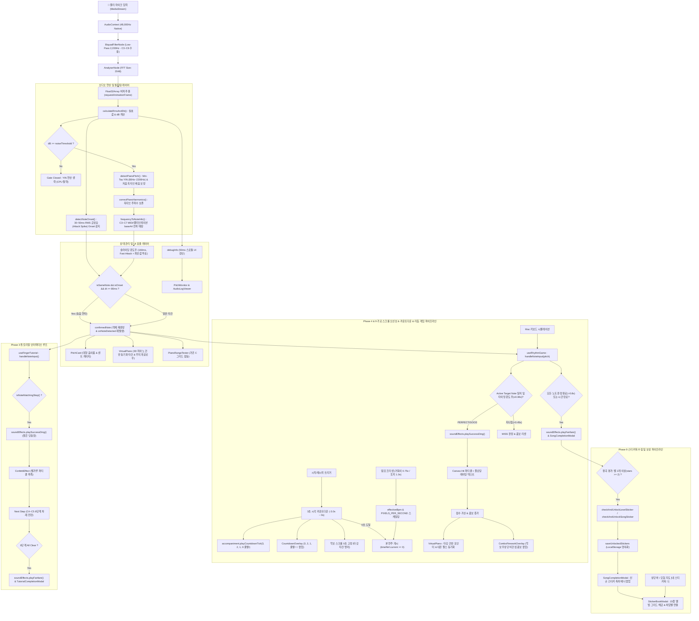

# Kids Piano Journey - System Architecture & Code Map

> 본 문서는 프로젝트의 전체 아키텍처, 데이터 흐름, 핵심 모듈 및 컴포넌트 간 상호작용을 분석하고 향후 리팩토링 및 기능 확장의 기준점이 되는 기술 명세서입니다.

---

## 1. Project Directory Layout

```text
Piano_start/
├── src/
│   ├── types/
│   │   ├── audio.ts                # 오디오 도메인 타입, NoteInfo, DetectedPitch, AudioLogEntry 모델
│   │   ├── tutorial.ts             # [Phase 3] 튜토리얼 도메인 모델 (TutorialStep, TutorialState)
│   │   ├── sheet.ts                # [Phase 4 & 9] 오선보/리듬 게임 도메인 모델 (SheetNote, SongMetadata, RhythmGameState, PlaybackSpeed)
│   │   ├── curriculum.ts           # [Phase 8] 10단계 모험 커리큘럼 도메인 모델 (CurriculumLevel, LevelProgress)
│   │   ├── sticker.ts              # [Phase 9] 스티커북 수집 시스템 도메인 모델 (RewardSticker, StickerCategory)
│   │   └── pitchfinder.d.ts        # Pitchfinder 라이브러리 TypeScript 앰비언트 선언
│   ├── views/                      # [Refactor] 4대 모드 뷰 분리 레이어
│   │   ├── AdventureModeView.tsx   # [Phase 8] 10단계 모험 커리큘럼 뷰 (지도 & 스테이지 연주 분기)
│   │   ├── SongPlayModeView.tsx    # [Phase 4 & 7] 동요 5곡 자유 연주 뷰
│   │   ├── TutorialModeView.tsx    # [Phase 3] 손가락 연습 튜토리얼 뷰
│   │   └── FreePlayModeView.tsx    # 자유 건반 연주 뷰
│   ├── utils/
│   │   ├── audioMath.ts            # 주파수<->MIDI 매핑, 센트 오차, RMS/dBFS 계산, Min-Tau YIN, 배음 보정, 8음 캘리브레이션 최근접 매핑(순수 함수)
│   │   ├── calibrationStorage.ts   # [Calibration] 피아노 8음(C4~C5) 조율 프로파일 모델 및 LocalStorage 영속화
│   │   ├── tutorialData.ts         # [Phase 3] 5손가락 스텝 데이터(C4~G4) 및 순수 타깃 매칭 함수
│   │   ├── soundEffects.ts         # [Phase 3] Web Audio API 기반 딩동댕 차임 및 축하 팡파르 사운드 합성기
│   │   ├── songParser.ts           # [Phase 7] 간이 텍스트/JSON 악보 파서 (createSong: 음이름+박자 -> SheetNote[] 자동 연산)
│   │   ├── songData.ts             # [Phase 4 & 7] 동요 5곡(비행기, 나비야, 작은별, 곰세마리, 환희의송가) 악보 데이터 및 순수 헬퍼
│   │   ├── curriculumData.ts       # [Phase 8] 10단계 커리큘럼 악보 및 손가락/연주 학습 팁 데이터베이스
│   │   ├── curriculumStorage.ts    # [Phase 8] 커리큘럼 진행도/별점/정답률 LocalStorage 영속화 및 해금 매니저
│   │   ├── stickerStorage.ts       # [Phase 9] 15종 스티커(10개 레벨 + 5곡 동요) 메타데이터 SSOT 및 해금 매니저
│   │   ├── audioContextManager.ts  # [Phase 4] 전역 단일 AudioContext 공유 싱글톤 매니저 (브라우저 컨텍스트 제한 해결)
│   │   └── accompanimentEngine.ts  # [Phase 4 & 7 & 9] Web Audio API 반주 엔진, 3초 카운트다운 틱 사운드, C4~G4 간섭 방지 마스터 EQ
│   ├── hooks/
│   │   ├── usePitchDetection.ts    # Web Audio API + YIN 알고리즘 + LPF 필터 + 슬라이딩 윈도우 + 캘리브레이션 동적 보정
│   │   ├── useKeyboardSimulation.ts # [Refactor] Mac 키보드(e.code/e.key/한글 자음) 피아노 시뮬레이션 전용 훅
│   │   ├── useFingerTutorial.ts    # [Phase 3] 오른손 5손가락 튜토리얼 상태 머신 및 인터랙티브 판정 훅
│   │   └── useRhythmGame.ts        # [Phase 4 & 9] 가로 스크롤 리듬 게임 루프 & 판정 훅 (모드별 독립 인스턴스화로 악보 상태 격리)
│   ├── components/
│   │   ├── sheet/                  # [Refactor] 캔버스 드로잉 서브루틴 모듈
│   │   │   ├── staffRenderer.ts    # 오선보 5선, 마디선, 높은음자리표, 타깃선 드로잉
│   │   │   ├── noteRenderer.ts     # 무지개 음표 머리/기둥/덧줄, 계이름 및 손가락 번호 렌더러
│   │   │   └── particleRenderer.ts # 적중 파티클 버스트 및 부유 레이팅 텍스트 렌더러
│   │   ├── IntroSplashScreen.tsx   # [Splash & Intro] 인트로 스플래시 화면 (고화질 스플래시 배경, 앱 아이콘, 마스코트 초대 가이드)
│   │   ├── CountdownOverlay.tsx    # [Phase 9] 연주 시작 3초 카운트다운(3, 2, 1, 출발! 🚀) 시각 오버레이
│   │   ├── ComboFireworkOverlay.tsx # [Combo & FX] 3/5/10/15연타 콤보 시 상단 우측 단정 배지 알림 (어린이 시야 집중을 위해 폭죽 이미지 배제)
│   │   ├── PitchCard.tsx           # 현재 감지된 음표의 대형 시각화 카드 (무지개 글로우, 센트 튜너 바)
│   │   ├── NoiseGateControl.tsx    # [UI] 실시간 볼륨 미터 및 노이즈 게이트(Threshold) 상시 조절 컨트롤러
│   │   ├── VirtualPiano.tsx        # [Phase 2 & 3 & 4] 3D 건반 (타깃 펄스 안내 '눌러요!' 포인터 및 네온 발광)
│   │   ├── HandGuideGraphic.tsx    # [Phase 3] 생성된 3D 아기 손(장갑) 마스코트(`hand_guide_mascot.png`) 기반 실시간 손가락 번호·음표 인터랙티브 가이드
│   │   ├── TutorialGuide.tsx       # [Phase 3] 손가락 연습 8단계 진행도 별, 타깃 음표 카드, 손가락 가이드, 힌트 배너, 마스코트 가이드
│   │   ├── TutorialCompletionModal.tsx # [Phase 3] 8단계 올클리어 트로피(고화질 에셋) 축하 모달
│   │   ├── SheetMusicCanvas.tsx    # [Phase 4 & 9] HTML5 Canvas 60fps 가로 스크롤 높은음자리표 오선보 & 무지개 음표 & 타깃선 & 파티클 & 템포 배속(0.75x/1.0x) 연동
│   │   ├── SongPlayHeader.tsx      # [Phase 4 & 9] 동요 리듬 게임 상단 헤더 (곡 정보, 5곡 탭, 콤보/점수 배지, 재생 컨트롤러, 거북이/토끼 속도 토글, 고대비 텍스트)
│   │   ├── SongSelectionCardList.tsx # [Phase 7] 알록달록 동요 5곡 가로 슬라이더 카드 리스트 (접이식 아코디언 토글 탑재, 고대비 텍스트)
│   │   ├── SongModeSoundMonitor.tsx # [Tablet Pad Standard] 연주 모드 전용 통합 사운드 모니터 (PitchCard + NoiseGate 일체형 패널)
│   │   ├── CurriculumMap.tsx       # [Phase 8 & 9] 10단계 구불구불 모험 길, 스테이지 발판, 자물쇠 잠금, 별점 및 스티커북 진입 버튼
│   │   ├── LevelIntroModal.tsx     # [Phase 8 & 9] 스테이지별 손가락 팁, 연주 팁, 템포 배속 토글 및 Wait Mode 진입 모달
│   │   ├── SongCompletionModal.tsx # [Phase 4 & 8 & 9] 완곡 축하 모달 (점수, 최대 콤보, 3단계 별점, 해금 스티커 축하 배너)
│   │   ├── StickerBookModal.tsx    # [Phase 9] 15종(10개 레벨 + 5곡 동요) 스티커 수집 앨범 그리드 및 해금 애니메이션 모달
│   │   ├── ConfettiEffect.tsx      # [Phase 3 & 4] 60fps 캔버스 기반 별가루/색종이 축하 파티클 이펙트
│   │   ├── PianoCalibrationModal.tsx # [Calibration] 도~높은도(C4~C5) 8음 피아노 맞춤 주파수 온보딩/재조율 위저드 모달
│   │   ├── SoundMixerModal.tsx     # [Phase 6 & 7] 배경 반주(MR) 및 효과음 볼륨 조절/음소거 믹서 모달
│   │   ├── PitchMonitor.tsx        # 엔지니어링 디버그 패널 (실시간 볼륨 바, 게이트 슬라이더, 키보드 시뮬레이터)
│   │   └── AudioLogViewer.tsx      # 실시간 타임스탬프 로그 터미널 및 클립보드 복사기
│   ├── App.tsx                     # 메인 오케스트레이터 (동요/모험 모드 간 오선보 리듬 게임 상태 분리 및 4대 독립 뷰 라우팅)
│   ├── main.tsx                    # React DOM 렌더링 진입점
│   └── index.css                   # Tailwind 지시자 및 모바일/태블릿 터치 제스처 리셋
├── public/
│   └── images/                     # 웹/APK 공용 정적 이미지 에셋 (Gemini 워터마크 무손실 Inpainting 100% 제거 완료)
│       ├── app_icon/               # 1:1 앱 아이콘 (워터마크 클린 복원)
│       ├── splash/                 # 16:9 가로 스플래시/시작 화면 (워터마크 클린 복원)
│       ├── backgrounds/            # 모드별 16:9 가로 배경 (동요/튜토리얼/자유연주 - 워터마크 클린 복원)
│       ├── effects/                # 클리어/트로피/별점 이펙트 그래픽
│       └── characters/             # 마스코트(고양이 지휘자 투명 RGBA 누끼 완료) 및 손가락 가이드 캐릭터
├── tests/
│   ├── audioMath.test.ts           # Tier 1 단위 테스트 (Min-Tau, 배음 보정, C4/G4 음표 매핑, RMS/dB)
│   ├── slidingWindow.test.ts       # Tier 2 통합 테스트 (Fast Attack 즉시 확정, 최빈값 투표, 서스테인)
│   ├── keyboardMapping.test.ts     # Tier 1 단위 테스트 (물리키/한글 자음 피아노 매핑 불변성 검증)
│   ├── tutorialFlow.test.ts        # [Phase 3] Tier 1 단위 테스트 (튜토리얼 5단계 및 타깃 순수 매칭 검증)
│   ├── rhythmGame.test.ts          # [Phase 4 & 9] Tier 1 단위 테스트 (비행기 악보, 오선보 Y좌표, 카운트다운/템포 연동)
│   ├── accompaniment.test.ts       # [Phase 4] Tier 1 단위 테스트 (8마디 코드 진행표 및 저음부 주파수 격리 검증)
│   ├── curriculum.test.ts          # [Phase 8] Tier 1 단위 테스트 (10단계 레벨 불변성, 70% 해금 룰, 최고점수 보존 검증)
│   └── sticker.test.ts             # [Phase 9] Tier 1 단위 테스트 (15종 스티커 무결성, 별 2개 해금 룰, 중복 방어 검증)
├── android/                    # [Phase 5] Capacitor Android 네이티브 프로젝트 (가로모드, 마이크 권한, KeepAwake)
│   ├── app/src/main/
│   │   ├── AndroidManifest.xml # 가로 모드 고정(sensorLandscape) & RECORD_AUDIO 권한
│   │   ├── java/.../MainActivity.java # 화면 꺼짐 방지(FLAG_KEEP_SCREEN_ON)
│   │   └── res/                # 고해상도 앱 아이콘 및 가로 스플래시 이미지
│   └── build/outputs/apk/debug/app-debug.apk # 최종 빌드된 Debug APK
├── docs/
│   └── refactoring/
│       ├── 2026-10-17_Phase1_Cleanup.md # Phase 1 클린업 리팩토링 명세서 및 실행 기록
│       ├── 2026-10-17_Phase2_Cleanup.md # Phase 2 키보드 훅 분리 및 AudioContext 최적화 명세서
│       ├── 2026-10-17_Phase3_Cleanup.md # Phase 3 튜토리얼 레이스컨디션 차단 및 오디오 자원 정리 명세서
│       ├── 2026-10-17_Phase4_Cleanup.md # Phase 4 60fps State 분리, 캔버스 최적화, 동적 완곡 모달 명세서
│       ├── 2026-10-17_PreAPK_Final_Audit.md # Pre-APK 기술 부채 7건 해소 감사 보고서
│       └── 2026-10-18_Comprehensive_Refactoring_Phase1_8.md # Phase 1~8 종합 리팩토링(View 분리, Canvas 서브루틴, SSOT 일원화, BackButton) 실행 명세서
├── PROJECT_AUDIT_REPORT.md         # 외부 시니어 아키텍트 점검용 종합 기술 감사 보고서
├── PROJECT_SPEC.md                 # 프로젝트 전체 요구사항 및 기획서
├── TASKS.md                        # 단계별 마일스톤 추적 트래커 (Phase 1 ~ Phase 5 All Complete)
├── AGENTS.md                       # Antigravity 에이전트 자동 로드 워크스페이스 전역 규칙
├── CODEMAP.md                      # 전체 시스템 아키텍처 및 코드 맵 (우선 참조 기준 문서)
├── capacitor.config.ts             # [Phase 5] Capacitor 전역 설정 (com.superfly.kidspianojourney)
├── package.json                    # 프로젝트 의존성 (React 18, Vite 6, Tailwind 3, Capacitor 7)
├── tailwind.config.js              # 무지개 테마 색상 토큰 정의
├── tsconfig.json                   # TypeScript 설정
└── vite.config.ts                  # Vite 번들러 설정
```

---

## 2. Core Audio & Rhythm Game Pipeline Data Flow



---

## 3. Module & Component Responsibility (SRP 분석)

| 파일 경로 | 모듈 분류 | 책임 및 핵심 로직 (Single Responsibility) |
| :--- | :--- | :--- |
| `src/types/audio.ts` | **Domain Models** | `NoteInfo`, `DetectedPitch`, `AudioLogEntry`, `PitchDetectionConfig` |
| `src/types/tutorial.ts` | **Domain Models** | [Phase 3 & Refactor] `TutorialStep`, `TutorialState` 튜토리얼 모델 명세 (C4~C5 8단계) |
| `src/types/sheet.ts` | **Domain Models** | [Phase 4, 6 & 7] `SheetNote`, `SongMetadata`(난이도, 설명, 아이콘 확장), `RhythmGameState`, `HitRating`, `RhythmPlayMode`('practice' | 'play'), `NotePitch`(C4~C5 확장) |
| `src/types/curriculum.ts` | **Domain Models** | [Phase 8] `CurriculumLevel`, `LevelProgress`, `LevelScoreRecord` 10단계 모험 커리큘럼 도메인 명세 |
| `src/types/sticker.ts` | **Domain Models** | [Phase 9] `RewardSticker`, `StickerCategory`('curriculum' | 'song'), `StickerBookProgress` 스티커북 모델 명세 |
| `src/utils/audioMath.ts` | **Pure Business Logic** | • `frequencyToMidi`: 주파수->MIDI 계산(캘리브레이션 `baseA4` 지원)<br>• `calculateRmsAndDb`: Float32 버퍼 RMS/dBFS 산출<br>• `detectPianoPitch`: Min-Tau Guard 피아노 80Hz~2200Hz YIN 추출 및 3옥타브 저음 2차 배음 역보정기<br>• `frequencyToNoteInfo`: C3~C7(MIDI 48~96, 6옥타브) 확장 매핑 및 캘리브레이션 오프셋 옥타브 전파<br>• `detectNoteOnset`: [Phase 6] 30~50ms RMS 급상승(Attack Spike) Onset 감지기 (서스테인 잔향 중 동음 연타 분리)<br>• `CORE_PIANO_KEYS`: 1옥타브(C4~C5 8건반) SSOT 메타데이터 및 `frequency`<br>• `getCoreKeyNoteInfo`: 표준 NoteInfo 생성기 |
| `src/utils/tutorialData.ts` | **Pure Business Logic** | [Phase 3 & Refactor] C4(도)~C5(높은도) 8단계 손가락 매핑 데이터 및 `isNoteMatchingStep` 순수 판정 함수 |
| `src/utils/songParser.ts` | **Pure Business Logic** | [Phase 7 & Post-Phase 7] 간이 텍스트/JSON 악보 파서 (`createSong`: 음이름+박자 튜플 배열 -> 비트 누적, 손가락 번호, 붐웨커 컬러, 마디 수 자동 연산, [Post-Phase 7] C4~C5 1옥타브 손가락 기본값 표준화) |
| `src/utils/songData.ts` | **Pure Business Logic** | [Phase 4 & 7] 동요 5곡(비행기, 나비야, 작은별, 곰세마리, 환희의송가) 악보 데이터, 곡 카탈로그(`SONG_CATALOG`), 박자<->초 변환, 오선보 C4~C5 Y좌표 계산 및 타이밍 판정 순수 헬퍼 |
| `src/utils/curriculumData.ts` | **Pure Business Logic** | [Phase 8] 10단계 모험 커리큘럼 악보 및 손가락 위치 팁(`handTip`), 구어체 연주 팁(`playTip`) 데이터베이스 (`CURRICULUM_LEVELS`, `getCurriculumLevel`) |
| `src/utils/curriculumStorage.ts` | **Persistence Service** | [Phase 8] 커리큘럼 진행도(`kids_piano_curriculum_progress`) 로드/저장/리셋 유틸리티 (70% 정답률 달성 시 다음 레벨 자동 해금, 최고 점수/별점 불변성 보존) |
| `src/utils/stickerStorage.ts` | **Persistence Service** | [Phase 9] 15종 스티커(10개 레벨 + 5곡 동요) 마스터 데이터(`STICKER_CATALOG`), 별 2개 이상 해금 검사(`checkAndUnlockLevelSticker`, `checkAndUnlockSongSticker`), LocalStorage(`kids_piano_unlocked_stickers`) 영속화 및 리셋 |
| `src/utils/audioContextManager.ts` | **Audio Core Manager** | [Phase 4 & Post-Phase 7] 전역 단일 AudioContext 공유 싱글톤 매니저 (브라우저 다중 컨텍스트 한도 초과 및 서스펜드 원천 차단, 마이크 분석 전용 컨텍스트 `getOrCreateMicContext` / `closeMicContext` 통합 관리) |
| `src/utils/accompanimentEngine.ts` | **Audio Synthesis** | [Phase 4, 7 & 9] Web Audio API 동요 반주(MR) 엔진 (베이스·화음 옥타브 배음 합성, [Phase 7] 피아노 C4~G4 기음 간섭 방지 마스터 EQ 버스(-18dB), [Phase 9] 3초 카운트다운 틱 사운드(`playCountdownTick`), `stop()` 즉각 잔향 차단 API, 5곡 전곡 코드 진행표 및 LocalStorage 볼륨/음소거 영속화) |
| `src/utils/soundEffects.ts` | **Audio Synthesis** | [Phase 3 & 7] Web Audio API 오실레이터 합성 (맑은 딩동댕 차임 및 축하 팡파르, MR 대비 귀를 찌르지 않는 마스터 볼륨 0.5 밸런스 튜닝, 볼륨/음소거 제어 및 LocalStorage 영속화) |
| `src/hooks/usePitchDetection.ts` | **Audio Engine** | • 브라우저 네이티브 AudioContext 수명주기를 `audioContextManager.getOrCreateMicContext`로 전역 싱글톤 통합 관리<br>• `yinThreshold`/`bufferSize` 원시값 추출을 통한 `useCallback` 참조 불변성 보장<br>• `cleanupAudio` 시 전역 오디오 컨텍스트 suspended 자동 복구 가드<br>• `getUserMedia` 하드웨어 AEC 및 노이즈 억제 활성화<br>• [Phase 7] HPF(80Hz, 터치/바람 럼블 컷) + Notch(1800Hz, 반주 틱 대역 저지) + LPF(2200Hz, 초고주파 컷) 3단 BiquadFilter 파이프라인으로 반주 크로스토크 원천 차단 및 순도 향상<br>• C3~C7 전 음역 실시간 시뮬레이션 지원<br>• `useRef` 격리 기반 슬라이딩 윈도우 피치 큐 & Fast Attack 음표 확정<br>• [Phase 6] `detectNoteOnset` 결합: 동음 연타(미-미-미) 시 80ms 쿨다운 기반 Attack Spike Onset 분리 및 `onNoteDetected` 개별 재발생 |
| `src/hooks/useKeyboardSimulation.ts` | **Input Adapter** | • Mac 키보드 물리키(`KeyA`~`KeyK`, `Digit1`~`8`) 및 한글 두벌식 키(ㅁ, ㄴ, ㅇ, ㄹ, ㅎ, ㅗ, ㅓ, ㅏ) C4~C5 1옥타브 전역 수신 및 디바운싱 |
| `src/hooks/useFingerTutorial.ts` | **Tutorial Engine** | [Phase 3 & Refactor] 튜토리얼 0~7단계 상태 머신, 타깃 판정, 사운드/별가루 락 제어, 단계 자동 전진 (레이스 컨디션 차단 타이머, 안정적 `handleNoteInput`, `stopTutorial` 시 `isCompleted` 완전 초기화) |
| `src/hooks/useRhythmGame.ts` | **Rhythm Game Engine** | [Phase 4, 6 & 9] 동요 리듬 게임 엔진 (`useMemo` 기반 곡 재생시간/effectiveBpm 메모이제이션, 60fps 시간 스트림을 React State와 분리하여 timeRef 직결, [Phase 9] -3.0s 시각 카운트다운 및 스크롤 정지 가드, 템포 배속(0.75x/1.0x) 연동, UI 100ms 스로틀 갱신, 실시간 판정, 모든 노트 판정 완료 시 완곡 가드, [Phase 6] '연습(기다려주기)' vs '실전(리듬)' 듀얼 모드) |
| `src/components/CountdownOverlay.tsx` | **Visual FX** | [Phase 9] 3, 2, 1, 출발! 🚀 3초 카운트다운 네온 펄스 오버레이 (`React.memo` 렌더 최적화, 스크롤 정지 연계) |
| `src/components/StickerBookModal.tsx` | **Modal View** | [Phase 9] 15종(10개 레벨 + 5곡 동요) 스티커 수집 앨범 그리드 및 해금 애니메이션 모달 (`useMemo` LocalStorage 캐싱, 신규 스티커 자동 포커싱, 터치 시 딩동댕 차임벨 연출) |
| `src/components/CurriculumMap.tsx` | **Curriculum Map View** | [Phase 8 & Refactor] 10단계 구불구불 모험 길, 알록달록 스테이지 발판(1~10), 자물쇠 오버레이, 획득 별점(★ 1~3개), 펄스 하이라이트, 전체 진척도 통계 뷰 및 2단계 인라인 모험 초기화(`onResetProgress`) 리셋 UI |
| `src/components/LevelIntroModal.tsx` | **Curriculum Modal** | [Phase 8] 스테이지별 손가락 위치 팁, 선생님 연주 팁, 붐웨커 목표 음표 색상 안내 및 [연습 시작하기 (Wait Mode)] 1클릭 진입 모달 |
| `src/components/SongSelectionCardList.tsx` | **Selection View** | [Phase 7 & Tablet Pad Standard] 알록달록 동요 5곡 가로 슬라이더 카드 리스트 (태블릿 세로 공간 140px 확보를 위한 아코디언 접기/펼치기 토글 탑재, '동요 앨범 (5곡)' / '곡 목록 닫기/다른 곡 골라보기' 직관적 UX) |
| `src/components/SongModeSoundMonitor.tsx` | **Integrated Monitor View** | [Tablet Pad Standard] 피아노 소리 감지기 (건반 쉘과 1:1로 일치하는 높이로 PitchCard 실시간 음표/센트 편차 + NoiseGate 볼륨 바/임계치 조절기를 단일 크리스탈 글래스 카드로 통합, 어린이 친화형 직관적 안내) |
| `src/components/ComboFireworkOverlay.tsx` | **UI / Visual FX** | [Phase 4 & 7] 악보 중앙 시야 및 어린이 집중 방해를 원천 차단하는 상단 우측 단정한 콤보 배너 (화려한 폭죽 이미지 배제, 3/5/10/15+ 콤보 마일스톤 1.2초 자동 소멸 및 상태 고착 방지) |
| `src/components/SheetMusicCanvas.tsx` | **Canvas View** | [Phase 4 & 6 & 7] HTML5 Canvas 60fps 가로 스크롤 오선보, 높은음자리표, 덧줄(C4), 무지개 음표, 타깃 판정선, 적중 파티클, [Phase 7] A4/B4/C5 오선보 Y좌표 및 무지개 컬러 완전 대응 ([Phase 6] 연습 모드 대기 시 타깃선 골드 펄스 글로우 및 상단 '눌러요!' 배지 렌더링) |
| `src/components/SongPlayHeader.tsx` | **Control View** | [Phase 4, 6, 7 & Post-Phase 7] 동요 연주 상단 헤더 (BPM, 진행바, 콤보 배지, 5곡 전곡 퀵 스위치 탭, 반주 On/Off 토글, '연습' vs '실전' 토글 스위치, 일시정지 시 '이어하기'(`onResume`) 재개 UX, 소리 크기 믹서 팝업 연동 버튼) |
| `src/components/SoundMixerModal.tsx` | **Control Modal** | [Phase 7 & Post-Phase 7] 배경 반주(MR) 및 효과음 볼륨 조절/음소거 믹서 모달 (App.tsx 내 단일 인스턴스 마운트 보장, 실시간 슬라이더, 딩동댕 소리 미리듣기, MR 90%/SFX 50% 황금 밸런스 1클릭 복원) |
| `src/components/SongCompletionModal.tsx` | **Modal View** | [Phase 4, 6, 8 & Post-Phase 7] 동요 완곡 축하 모달 (곡명 동적 바인딩, 3단계 성취도 평가[별1/2/3개], [Post-Phase 7] 연습 모드 완곡 시 100% 정답률 보장 및 0음표 분모 방어, 별 1~3개 순차 점등 애니메이션, Web Speech API 기반 한국어 맞춤 칭찬 음성 출력, 점수/콤보/퍼펙트 통계, 엠블럼 에셋, [Phase 8] 커리큘럼 모드 전용 [다음 레벨 도전! 🚀] 트랜지션 연동) |
| `src/components/HandGuideGraphic.tsx` | **Visual Guide** | [Phase 3 & Refactor] 오른손 5손가락 SVG 벡터 그래픽 및 현재 타깃 손가락 펄스 애니메이션 (1옥타브 도~높은도 8음 대응) |
| `src/components/TutorialGuide.tsx` | **Presentation View** | [Phase 3 & Refactor] 8단계 진행도 별 표시, 타깃 음표 대형 카드, '처음부터'(`onRestart`) 리셋 버튼, 인터랙티브 힌트 안내 |
| `src/components/TutorialCompletionModal.tsx` | **Modal View** | [Phase 3 & Refactor] 1옥타브 8음 완주 축하 트로피 모달 (다시 연습하기 / 자유 연주하기) |
| `src/components/ConfettiEffect.tsx` | **Visual FX** | [Phase 3 & 4] 60fps 경량 캔버스 별가루/색종이 폭죽 파티클 효과 (튜토리얼/연주/커리큘럼 모드별 활성 상태에 맞춰 분기 격리) |
| `src/components/VirtualPiano.tsx` | **Interactive View** | • 1옥타브(C4~C5) 8개 3D 키즈 피아노 건반<br>• 튜토리얼 및 리듬게임 활성화 시 타깃 건반 '눌러요!' 바운스 뱃지 및 네온 펄스 가이드 연동 |
| `src/components/NoiseGateControl.tsx` | **Audio Control View** | • 메인 뷰 상시 노출 노이즈 게이트(Threshold) 조절 슬라이더(-70~-20dB) |
| `src/components/PitchCard.tsx` | **Presentation View** | • 현재 확정된 음표의 한글/영문 대형 카드 렌더링 (센트 편차 튜너 바 표출) |
| `src/components/PianoRangeTester.tsx` | **Verification View** | • [Deprecated] 초기 프로토타입 1옥타브 인식 그리드 (App.tsx UI에서 제거 및 VirtualPiano로 일원화) |
| `src/components/PitchMonitor.tsx` | **Debug Control** | • 실시간 RMS dB 레벨 미터, 노이즈 게이트 슬라이더 조절, C4~C5 8음 키보드 시뮬레이터 |
| `src/components/AudioLogViewer.tsx` | **Diagnostic Tool** | • 실시간 오디오 이벤트(타임스탬프, dB, Hz, 음이름) 스트림 표시 및 원클릭 복사 |
| `src/views/AdventureModeView.tsx` | **Mode View** | [Phase 8] 10단계 모험 커리큘럼 뷰 (모험 지도 뷰 및 스테이지 연주 분기, 스티커북 진입 바 연동) |
| `src/views/SongPlayModeView.tsx` | **Mode View** | [Phase 4 & 7] 동요 5곡 자유 연주 뷰 (5곡 슬라이더, 리듬 헤더, 오선보 캔버스, 가상 건반 통합) |
| `src/views/TutorialModeView.tsx` | **Mode View** | [Phase 3] 오른손 5손가락 자리 튜토리얼 뷰 (손가락 가이드, 타깃 음표 카드, 가상 건반 연동) |
| `src/views/FreePlayModeView.tsx` | **Mode View** | 자유 건반 연주 뷰 (3D 가상 건반 및 사운드 모니터) |
| `src/App.tsx` | **Application Orchestrator** | • 태블릿 가로/데스크톱 2-Column Responsive Dashboard 오케스트레이션<br>• [모험 모드 🗺️], [동요 자유 연주 🎵], [손가락 연습 🖐️], [자유 연주 🎹] 4대 모드 간 실시간 스위칭<br>• [Post-Phase 7] SoundMixerModal 단일화 및 playModeRef 기반 음표 연동 격리 |

## 4. Refactoring & Test Shield Status (Completed)

1. **테스트 하네스 구축 (Tier 1 & Tier 2 100% Green)**:
   - `tests/audioMath.test.ts`: 순수 수학 함수, Min-Tau 19kHz 차단, C4/G4/C5 주파수 매핑 및 C5 원음 보존 100% 통과.
   - `tests/slidingWindow.test.ts`: Fast Attack 단일 타건 확정, 최빈값 투표, 만료 가지치기, 서스테인 타임아웃 검증.
   - `tests/keyboardMapping.test.ts`: Mac 물리키(KeyA~K, Digit1~8) 및 한글 두벌식 키(ㅁ~ㅎ, ㅗ, ㅓ, ㅏ) 매핑 불변성 검증.
   - `tests/tutorialFlow.test.ts`: [Phase 3 & Refactor] 1번(도)~높은도(C5) 8단계 손가락 순서 불변성, SSOT 주파수 검증, getCoreKeyNoteInfo 및 soundEffects 라이프사이클 100% 통과.
   - `tests/rhythmGame.test.ts`: [Phase 4] 동요 2곡(비행기, 나비야) 26음표 악보 데이터 불변성, 박자<->초 정밀도, 오선보 기하 정렬, 판정 범위, 완곡 모달 동적 타이틀 및 Boomwhackers 표준 무지개 색상 토큰 100% 통과.
   - `tests/accompaniment.test.ts`: [Phase 4] 8마디 C/G7 코드 진행표, C4(261Hz) 미만 저음부 주파수 격리 및 음소거/볼륨 제어 100% 통과.
2. **Phase 1 ~ Phase 4 점진적 클린 아키텍처 완성**:
   - 오디오 피치 감지 레이어, 5손가락 튜토리얼 상태 머신, 가로 스크롤 오선보 리듬 게임 엔진이 완벽한 단방향 의존성으로 격리.
   - [Phase 4 Refactor] 60fps 오선보 캔버스 애니메이션과 React State가 완전히 분리(Decoupled)되어 `timeRef`/`getCurrentTimeSec` 직결 렌더링 및 UI 100ms 스로틀링으로 초당 60회 전면 리렌더링 원천 차단.
   - 실제 피아노 마이크 연주뿐 아니라 Mac 키보드(`A~K`, `1~8`, 한글 자모음)로도 모든 1옥타브 피아노 시뮬레이션 즉시 가능.
3. **Phase 5 안드로이드 태블릿 최적화 및 APK 빌드 완료**:
   - Capacitor 7 초기화 (`com.superfly.kidspianojourney`) 및 Android 네이티브 브리지 구성.
   - `AndroidManifest.xml`: 태블릿 전용 가로 모드 고정(`sensorLandscape`), 마이크 권한(`RECORD_AUDIO`, `MODIFY_AUDIO_SETTINGS`), 화면 유지 권한(`WAKE_LOCK`) 주입.
   - `MainActivity.java` `FLAG_KEEP_SCREEN_ON` 및 `@capacitor-community/keep-awake` 이중 잠금으로 어린이 연주 중 화면 꺼짐 원천 차단.
   - 고해상도 앱 아이콘(1:1) 및 가로 스플래시 이미지(16:9) Android `res/` mipmap 및 drawable 해상도별 동기화.
   - Java 21 기반 Gradle `assembleDebug` 성공 빌드 및 실기기(Lenovo Tab TB331FC, Android 15) adb 스트리밍 설치 및 권한 자동 부여 완료.
4. **Phase 6 Commercial Polish: Energy Onset 피치 감지기 완료**:
   - `detectNoteOnset`: 30ms~50ms 구간의 피아노 타건 해머 트랜지언트(Attack Spike, 4.5dB 이상)를 감지하는 순수 수학 유틸 구축.
   - `usePitchDetection`: 서스테인 잔향 중 '미-미-미' 동음 연타 시 80ms 쿨다운 가드를 통해 개별 노트를 정확히 분리하고 `onNoteDetected` 이벤트 재트리거.
   - `tests/audioMath.test.ts` 및 `tests/slidingWindow.test.ts`: 서스테인 감쇠 무시, 35ms 급상승 검출, 경계값(4.0dB vs 5.0dB), 쿨다운 채터링 방지 100% Green 통과.
5. **Phase 6 Commercial Polish: 학습자를 위한 Wait Mode(기다려주기 모드) 완료**:
   - `useRhythmGame`: '연습(기다려주기)' vs '실전(리듬)' 듀얼 모드 아키텍처 탑재.
   - 연습 모드: 타깃 노트가 판정선에 도달하면 악보 스크롤을 자동 일시정지하고, 아이가 해당 건반을 칠 때까지 무한 대기(MISS 원천 차단). 올바른 건반 타건 시 '딩동댕' 차임 및 다음 음표 위치로 스크롤 즉시 재개.
   - `SongPlayHeader` & `SheetMusicCanvas`: 원터치 모드 토글 스위치, 대기 중 타깃선 골드 펄스 글로우 및 상단 '눌러요!' 배지 렌더링.
   - `tests/rhythmGame.test.ts`: 타깃선 도달 시 시간 정지, 건반 입력 시 대기 해제 및 다음 음표 전진 시뮬레이션 100% Green 통과.
6. **Phase 6 Commercial Polish: 결과 화면 게이미피케이션 완료**:
   - `SongCompletionModal`: 정답률(Accuracy %) 실시간 프로그레스 게이지, 별 1~3개 순차 점등(Staggered scale) 애니메이션.
   - 유아 친화형 음성 칭찬: Web Speech API(`speechSynthesis`, 'ko-KR') 기반으로 달성도에 맞춘 따뜻한 음성 칭찬(3성: "와아! 완벽해요! 참 잘했어요! 피아노 마스터예요!") 자동 발화 연동.
7. **Phase 7: Content Expansion & Audio Purity 완료**:
   - `songParser` (`createSong`): 음이름과 박자만 나열하는 간이 튜플 배열(`[["C4", 1], ["G4", 1], ["A4", 2]]`)로부터 비트 누적, 1~5번 손가락 번호, 붐웨커 무지개 컬러, 마디 수를 자동 연산하는 악보 생성 파서 구축.
   - 동요 5곡 카탈로그(`SONG_CATALOG`): 비행기(★☆☆), 나비야(★☆☆), 작은 별(★★☆, A4 라 피치 확장), 곰 세 마리(★★☆), 환희의 송가(★★★) 전수 탑재.
   - `SongSelectionCardList`: 메인 화면 상단 알록달록 무지개 크리스탈 글래스 동요 선택 카드 슬라이더 구축 (이모지, 난이도별, BPM, 음표 수, 원터치 선택 및 연주 직결).
   - 반주 엔진 음색 이퀄라이징: `accompanimentEngine` 출력단에 피아노 C4~G4(260~400Hz) 기음 대역을 -18dB 감쇠시키는 마스터 Peaking/Notch EQ 버스 탑재로 스피커 출력 배음이 마이크로 유입되는 크로스토크 원천 차단.
   - 마이크 입력 체인 다단 BiquadFilter 파이프라인: `usePitchDetection`에 HPF(80Hz, 터치/럼블 컷) + Notch(1800Hz, 반주 퍼커션 틱 저지) + LPF(2200Hz, 초고주파 노이즈 컷) 3단 필터 체인 주입으로 마이크 입력 순도 극대화.
   - `tests/rhythmGame.test.ts` & `tests/accompaniment.test.ts`: 파서 연산, 5곡 악보 불변성, C4~C5 오선보 Y좌표, 8마디 코드 진행표 100% Green 통과.

8. **Phase 8: 10-Level Step-by-Step Curriculum Mode 완료**:
   - `curriculum`: `CurriculumLevel`, `LevelProgress` 도메인 모델 및 10개 레벨 완곡 악보/손가락 위치 팁/연주 팁 SSOT 완성 (`src/utils/curriculumData.ts`).
   - `curriculumStorage`: LocalStorage 기반 70% 정답률 다음 레벨 자동 해금, 별점 최고치 보존, 1레벨 초기화 영속화 매니저 (`src/utils/curriculumStorage.ts`).
   - `CurriculumMap` & `LevelIntroModal`: 구불구불 이어지는 10개 스테이지 모험 지도, 해금 펄스, 자물쇠 오버레이, 학습 안내 팁 및 Wait Mode 원터치 진입.
   - `SongCompletionModal`: 커리큘럼 모드 완곡 시 [다음 레벨 도전! 🚀] 트랜지션 연동 및 자동 갱신.
   - `App.tsx`: 4대 모드 탭(`[모험 모드 🗺️]`, `[동요 자유 연주 🎵]`, `[손가락 연습 🖐️]`, `[자유 연주 🎹]`) 오케스트레이션 및 모험 지도 <-> 오선보 연습 모드 완벽 배선.
   - `tests/curriculum.test.ts`: 10개 레벨 무결성, 70% 해금 룰, 점수 보존, 리셋 단위 테스트 100% Green 통과 및 `npm run build` 검증 완료.

9. **Phase 9: Countdown & Speed Control 완료**:
   - `useRhythmGame`: 시작 시 3초 시각 카운트다운(`countdown: 3 | 2 | 1 | 'GO'`) 및 틱 사운드 연출, 카운트다운 중 악보 스크롤 0위치 정지 가드(`Math.max(0, curTime)`), '출발! 🚀' 시점 정식 타이머 가동.
   - 템포 프리셋(0.75x/1.0x): `speed: PlaybackSpeed(0.75 | 1.0)`, `effectiveBpm` 및 `PIXELS_PER_SECOND` 연동으로 거북이 모드(0.75배속) 선택 시 1박 지속 시간 증가 및 캔버스 스크롤 완화.
   - UI 통합: `CountdownOverlay` 캔버스 오버레이, `SongPlayHeader` 거북이/토끼 토글 버튼, `LevelIntroModal` 스테이지 진입 전 속도 선택기 탑재.
   - `tests/rhythmGame.test.ts`: 3초 카운트다운 상태 전이, 스크롤 정지 불변성, 템포 배속 연동 테스트 100% Green 통과.


---

## 5. UI/UX Design System & Theme Architecture (Commercial-Grade Frosted Crystal Glass)

- **슬레이트(Slate) 틴트 완전 제거 및 초투명 크리스탈 글래스 체계 전면 도입**:
  - 탁하고 어두운 먹색 슬레이트(`bg-slate-900/40~90`, `bg-slate-950/75`) 및 암막 비네팅을 전면 제거.
  - 고화질 배경 일러스트(동요 비행기 하늘/구름, 음악 공부방, 은하수 네온 오로라)가 100% 투과되는 애플 visionOS / iPadOS 스타일의 **초투명 루미너스 크리스탈 글래스(`bg-white/[0.08~0.15] backdrop-blur-2xl border border-white/30~35 shadow-[0_8px_32px_rgba(0,0,0,0.18)]`)** 규격 통일.
- **SheetMusicCanvas 투명 캔버스**:
  - 캔버스 내부 어두운 슬레이트 그라데이션 필을 완전 배제(`ctx.clearRect`), 투명 캔버스 위에 화이트 글래스 오선보(`rgba(255,255,255,0.45)`) 및 실버 높은음자리표를 올려 배경 일러스트가 악보 뒤로 선명하게 투과되는 HUD 뷰 완성.
- **시인성 및 고대비 가독성 보장**:
  - 텍스트에는 `drop-shadow-[0_2px_4px_rgba(0,0,0,0.8)]` 및 세부 수치 박스에 `bg-black/25 backdrop-blur-md border border-white/15`를 적용하여 화사한 일러스트 위에서도 100% 또렷한 시인성 확보.

---

## 6. Tablet Landscape Pad Ratio Architecture Standard (황금비율 패드 규격 기억)

> 안드로이드 태블릿(16:10 / 16:9, 예: 1280x800, 1920x1200, 2560x1600) APK 실행 환경에서 세로 스크롤 없이(Zero-Scroll) 모든 인터랙션 요소가 한 화면에 100% 수납되는 황금비율 아키텍처 표준 명세입니다.

### A. Viewport & Vertical Budget Allocation (가용 세로 뷰포트 분배)
- **가용 뷰포트 기준**: 태블릿 가로 모드 기준 가용 세로 높이 약 550px ~ 750px (시스템 바 및 네비게이션 바 제외).
- **1단 상단 글로벌 헤더 (`App.tsx header`)**:
  - 높이: ~48px (단일 행 고정, flex-nowrap)
  - 패딩: `px-3 py-1.5 sm:py-2`, 로고 `w-8 h-8 sm:w-9 sm:h-9`
- **2단 곡 선택 아코디언 (`SongSelectionCardList`)**:
  - 기본 상태 접힘(Collapsed): 높이 36px 글래스 캡슐 바 (`현재 곡 표출 및 열기/접기 버튼`).
  - 사용자가 곡을 탐색할 때만 아코디언 슬라이더가 펼쳐지며, 평소 연주 화면에서 **세로 140px 원천 세이브**.
- **3단 연주 모드 헤더 (`SongPlayHeader`)**:
  - 높이: ~50px 고밀도 슬림 글래스 바.
  - 마스코트(w-8 h-8), 곡명, 5곡 원터치 전환 칩 탭, 연습/실전 토글, 점수/콤보 배지, 재생/일시정지/리셋 컨트롤러, 진행바 일체형 수납.
- **4단 오선보 캔버스 (`SheetMusicCanvas`)**:
  - 높이: `h-32 sm:h-36 md:h-40` (128px ~ 152px).
  - 5선 간격(`lineSpacing = height * 0.115`, 13~16px) 및 `line1Y = height * 0.60` 동적 황금비 스케일링으로 시원한 가로 스크롤 및 높은 가독성 확보.
- **5단 하단 건반 & 모니터 영역 (`md:grid-cols-12` Side-by-Side 분할)**:
  - **좌측 8열 (`VirtualPiano`)**: 건반 컨테이너 높이 `h-26 sm:h-28 md:h-32` (104px~128px), 어린이 터치 최소 규격(48px+) 2배 이상 초과 충족, 쉘 전체 높이 ~160px.
  - **우측 4열 (`SongModeSoundMonitor`)**: 건반과 1:1로 동일한 높이(`h-full`)를 갖는 단일 크리스탈 글래스 쉘에 `PitchCard`(실시간 음표/센트 편차)와 `NoiseGateControl`(볼륨 바/게이트 임계치 슬라이더)을 통합 배치.
  - **세로 적층 문제 완전 차단**: `lg:grid-cols-12`(1024px) 대신 `md:grid-cols-12`(768px)를 적용하여 안드로이드 태블릿(800~960px 뷰포트)에서 하단부가 1열로 떨어져 오선지 아래가 짤리는 현상을 원천 방지.
- **총 세로 높이 합산**: 약 410px ~ 430px (전체 태블릿 가로 화면에서 스크롤 0%의 완벽한 One-Screen 밸런스 달성).

---

## 7. Deployment & CI/CD Architecture (GitHub & Vercel)

- **GitHub Repository**:
  - URL: `https://github.com/SuperFLY22/kids-piano-journey`
  - Default Branch: `main`
- **Vercel Production Deployment**:
  - Project ID: `prj_WKlrwhLQOUMSbt2qCWyBnMYP4lBt`
  - Production URL: `https://kids-piano-journey.vercel.app`
  - Secondary Alias: `https://kids-piano-journey-superfly22s-projects.vercel.app`
  - Framework: Vite (`npm run build`, output: `dist`)
- **Automated CI/CD**:
  - `git push origin main` 발생 시 Vercel 자동 빌드 및 실시간 배포 연동 완료.


